<picture>
  <source media="(max-width: 600px)" srcset="assets/applied-ai-lab-mobile.svg" />
  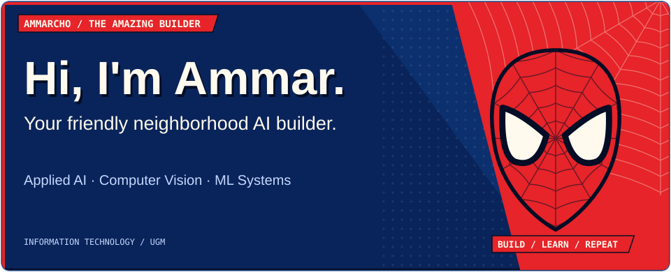
</picture>

<a href="#selected-work">Selected work</a> &nbsp; / &nbsp; <a href="#toolkit">Toolkit</a> &nbsp; / &nbsp; <a href="#build-log">Build log</a> &nbsp; / &nbsp; <a href="https://www.instagram.com/xyammar/">Connect ↗</a>

<picture>
  <source media="(max-width: 600px)" srcset="assets/about-mobile.svg" />
  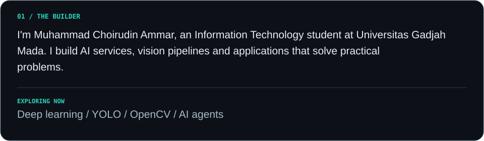
</picture>

<picture>
  <source media="(max-width: 600px)" srcset="assets/selected-work-mobile.svg" />
  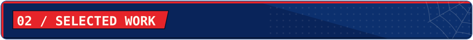
</picture>

<a href="https://github.com/astrorehan/panen-cerdas">
<picture>
  <source media="(max-width: 600px)" srcset="assets/panen-cerdas-mobile.svg" />
  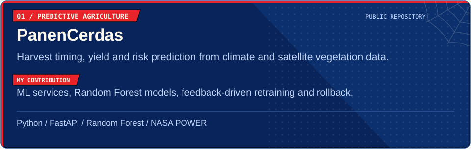
</picture>
</a>

<a href="https://github.com/astrorehan/prakira">
<picture>
  <source media="(max-width: 600px)" srcset="assets/prakira-mobile.svg" />
  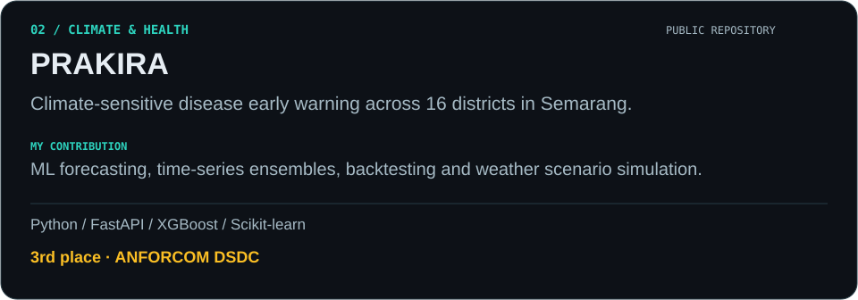
</picture>
</a>

<picture>
  <source media="(max-width: 600px)" srcset="assets/pantas-mobile.svg" />
  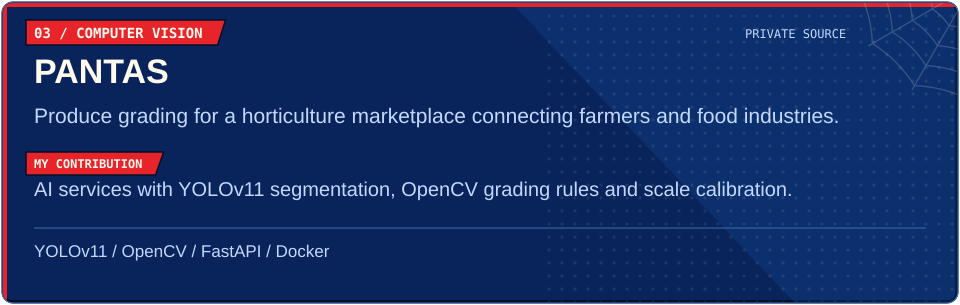
</picture>

<picture>
  <source media="(max-width: 600px)" srcset="assets/portal-scanning-mobile.svg" />
  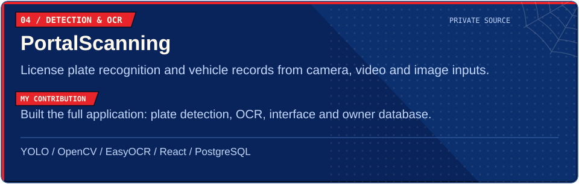
</picture>

<picture>
  <source media="(max-width: 600px)" srcset="assets/drawing-extractor-mobile.svg" />
  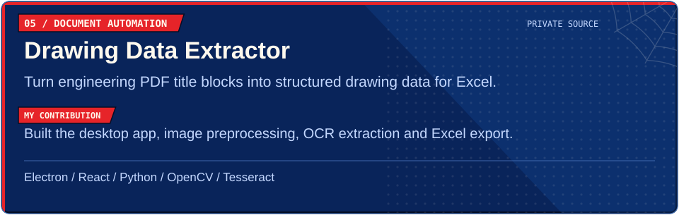
</picture>

<picture>
  <source media="(max-width: 600px)" srcset="assets/toolkit-mobile.svg" />
  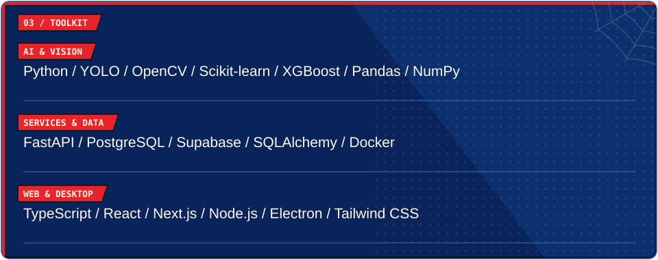
</picture>

<a href="https://github.com/ammarcho?tab=overview">
<picture>
  <source media="(max-width: 600px)" srcset="assets/activity-mobile.svg" />
  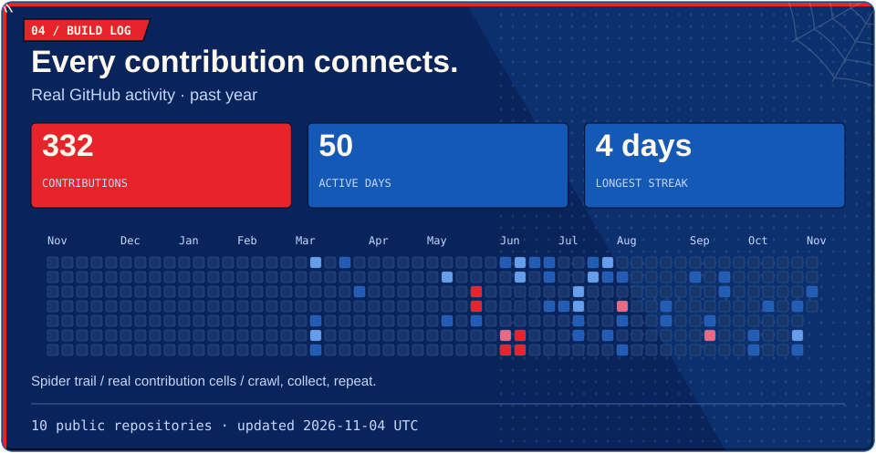
</picture>
</a>

<a href="https://github.com/ammarcho?tab=repositories">
<picture>
  <source media="(max-width: 600px)" srcset="assets/connect-mobile.svg" />
  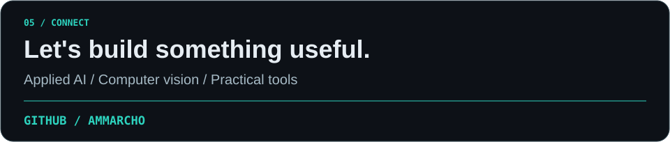
</picture>
</a>
